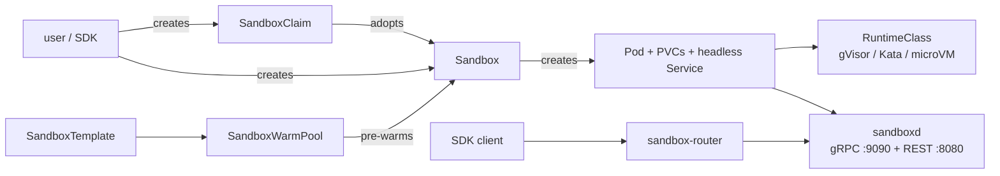

# Agent Sandbox: reference and integration shape

Research notes on [`kubernetes-sigs/agent-sandbox`](https://github.com/kubernetes-sigs/agent-sandbox)
and how it would map onto Multica's runtime model. Nothing here is implemented yet.

- Upstream: `sigs.k8s.io/agent-sandbox`, Apache-2.0, SIG Apps. **Not** an upstream-Kubernetes
  project (not under `k8s.io/*`).
- Latest release at time of writing: `v1.0.10` (2026-11-06). API group `agents.x-k8s.io`,
  `v1beta1` is the only served version.
- Requires Kubernetes ≥1.25 for CRD CEL validation (≥1.29 recommended); the Gateway API v1.5
  CRD bundle the router docs reference needs ≥1.31.

## What it is

A **sandbox orchestrator**, not a sandbox. It supplies a declarative API for one long-lived,
stateful, singleton pod with stable identity and durable storage — "a lightweight single-container
VM experience" — and delegates actual isolation to a runtime (gVisor, Kata, Firecracker, urunc)
selected through `RuntimeClass`. Isolation is never implemented by the project itself.

### Core CRD: `Sandbox`

One pod, one identity, optional PVCs. Key fields:

| Field | Semantics |
|---|---|
| `spec.podTemplate` | Pod spec. Only labels/annotations propagate to a running pod; other edits apply on the next pod creation (resume, or pod deletion). |
| `spec.volumeClaimTemplates` | **Immutable after creation.** Named `<template>-<sandbox>`, owned by the Sandbox, survive suspend, GC'd with the Sandbox. Max 128. |
| `spec.service` | `*bool`. `true` creates a headless Service; unset preserves a pre-existing Service but creates none (backward compat); `false` removes it. |
| `spec.failedPodPolicy` | `Retain` (default, surfaces `Finished=True`) or `Recreate` (replaces a Failed pod with Deployment-style backoff 5s→5m, reset after 10 min Running). |
| `spec.operatingMode` | `Running` (default) or `Suspended` — kills the pod, keeps the CR and PVCs, resume reattaches volumes. |
| `spec.lifecycle.shutdownTime` / `shutdownPolicy` | Absolute expiry. `Delete` or `Retain` (default). Child pod/Service are always deleted on expiry. |

Status: `Ready` is the only readiness truth (pod Running + Ready + at least one IP + Service
exists when required). There is deliberately no separate `Running` condition. Reasons include
`DependenciesNotReady`, `SandboxSuspended`, `PodTerminating`, `PodSucceeded`/`PodFailed`,
`SandboxExpired`, `MultiplePods`, `InvalidConfiguration` (permanent, stops requeueing),
`ReconcilerError`. `Suspended`, `PodScheduled`, `Finished` are supplementary.

### Extension CRDs

| CRD | Role |
|---|---|
| `SandboxTemplate` | Reusable blueprint plus **security policy**: managed `NetworkPolicy` (default-deny; ingress only from the router; egress public-internet only, blocking RFC1918 and metadata endpoints), `automountServiceAccountToken: false` default, `envVarsInjectionPolicy{Disallowed,Allowed,Overrides}`, `volumeClaimTemplatesPolicy{Disallowed,Allowed,Overrides}`, `networkPolicyManagement{Managed,Unmanaged}`. |
| `SandboxWarmPool` | Pre-warmed replicas with a scale subresource (HPA/KEDA). `updateStrategy{Recreate,OnReplenish}`; staleness is blueprint-hash based, so metadata-only edits never recycle. Claimed sandboxes leave pool ownership permanently. |
| `SandboxClaim` | Checkout from a pool. `lifecycle.shutdownTime`, `ttlSecondsAfterFinished`, `shutdownPolicy{Delete,DeleteForeground,Retain}`. Setting `env` or `volumeClaimTemplates` forces a cold start — those cannot be injected into a running warm pod. |

## Data plane

### `sandboxd` — in-pod runtime daemon

Reference implementation of KEP-539.2's standardized runtime contract. Both ports bind `0.0.0.0`
by default; containment is pod isolation + NetworkPolicy, not loopback.

| Surface | Port | Operations |
|---|---|---|
| `process.v1.ProcessService` (gRPC) | 9090 | `Start` (server stream, optional PTY), `Execute` (unary), `ExecuteWithLimits` (time + output budgets, structured outcomes), `WriteStdin`, `SendSignal` (INT/TERM/KILL), `ResizeTTY` |
| `watcher.v1.FileWatcherService` (gRPC) | 9090 | `WatchDir` (optional recursive; ~250 ms batches; terminal conditions arrive as a final `ERROR` event, not a status code) |
| Filesystem REST | 8080 | `GET/HEAD/PUT/DELETE /v1/files/{path}`, `POST …:move`, `POST …:copy`, `?recursive`, `?append`, `?extract=tar`, `?type=directory`, `If-None-Match: *` create-only; `GET /v1/health`, `GET /v1/metadata` |

Semantics that matter for an orchestrator:

- `Start` emits `InitEvent` → `stdout`/`stderr` byte chunks → `ExitEvent`. A nonzero exit code is a
  business result, not an SDK error. Output chunks are not line-aligned or guaranteed UTF-8;
  stdout and stderr have no global ordering.
- `Execute` returns `RESOURCE_EXHAUSTED` on timeout or truncation because it cannot express partial
  results; `ExecuteWithLimits` returns retained output plus `termination_reason`.
- Exit codes follow shell convention: `128+n` for a signal death.
- Writes are atomic (temp + rename) except `?append`; create-only writes rely on hard links and fail
  on GCS FUSE-like volumes.
- Paths and process `cwd` resolve symlink-aware against `--root-dir` (`/workspace` default);
  escapes get `403 PERMISSION_DENIED`.
- `/v1/metadata` only exposes `--metadata-env-prefix` (default `SANDBOX_`) names and always
  withholds anything matching `TOKEN|SECRET|PASSWORD|PASSWD|CRED|KEY|AUTH|BEARER|PRIVATE|CERT`.
- Optional `--auth-token-sha256` (or `--auth-token-file`) bearer check; also accepts
  `X-Sandboxd-Token`, which is what clients send through the router because the router strips
  `Authorization`. `/v1/health` stays open for kubelet probes.
- Deployment topology is a real decision: the daemon executes commands **in whichever container
  hosts it**. A shared `/workspace` volume shares files, not binaries. Running it as a sidecar next
  to the workload gives loopback clients, not the workload image's toolchain.

### `sandbox-router` — stateless reverse proxy

Routes by headers or path; never creates or looks up Sandbox objects.

| Header | Notes |
|---|---|
| `X-Sandbox-ID` | Required, DNS-1123 label. |
| `X-Sandbox-Namespace` | Default `default`, same validation. |
| `X-Sandbox-Port` | Default `8888`; sandboxd uses 8080/9090. |
| `X-Sandbox-UID` | Optional; pins an incarnation. |
| `X-Sandbox-Pod-IP` | Optional bypass of cache and DNS. Rejects loopback/link-local/multicast/unspecified — this class check is the only SSRF defense under the default `AllowAll` authorizer. |

Resolution order: `X-Sandbox-Pod-IP` → informer-cache lookup (`--cache-enabled`, UID + a
namespace/name index) → DNS `<id>.<ns>.svc.<cluster-domain>`. Unclaimed warm-pool members are in
the cache but not name-indexed, so they are reachable only by exact UID.

Other behavior: strips inbound `Host` and `Authorization`; native gRPC and gRPC-Web (unary and
server-streaming only) transcoding; WebSocket upgrades passed through with per-request timeout
disabled and `Origin` stripped (code-server/vscode-server CSRF); optional `--path-routing-prefix`
for browsers that cannot set headers, with `Location`/`Set-Cookie` rewriting; dial-class retries
only (3 by default, 200/400/800 ms), never replaying a possibly-sent body.

### SDKs

- **Go**: `sigs.k8s.io/agent-sandbox/clients/go/sandbox` (root module tags). Connectivity
  `port-forward` (default), `router-port-forward`, `in-cluster-service`, `in-cluster-pod-ip`;
  Gateway mode. `Close()` deletes the claim, `Disconnect()` keeps it — the "keep the sandbox warm
  between requests" primitive. `Handle`/`Info` interfaces exist for fakes.
- **Python**: `pip install k8s-agent-sandbox`, gRPC extra for the process surface.
- **TypeScript**: in progress upstream, not usable.
- `Run` defaults to a single attempt everywhere (not idempotent); file operations retry.

## Security model

Trust boundaries are explicit: controller and router are trusted, sandbox pods are untrusted (they
run LLM-generated code).

| Threat | Control |
|---|---|
| Container escape | `RuntimeClass` (gVisor/Kata) chosen in the template; not implemented by the project |
| Cross-tenant network | Template-managed default-deny NetworkPolicy; RFC1918 and metadata endpoints blocked on egress |
| Kubernetes API abuse | `automountServiceAccountToken: false` default for template-provisioned sandboxes; bare `Sandbox` needs admission control |
| Traffic hijack via label spoofing | `agents.x-k8s.io/*` and `extensions.agents.x-k8s.io/*` keys are stripped from user pod templates; the Service selector hash is applied after merging |
| Router SSRF | IP-class validation on `X-Sandbox-Pod-IP`; class check is the whole defense unless a custom authorizer is configured |
| Router DoS | Not handled — push rate limiting and connection caps to the Gateway/Envoy tier |

Documented gaps, not speculation — they matter when choosing defaults:

1. `authz.AllowAll` is the router default. `tokenreview` only authenticates a caller; it does not
   authorize a specific sandbox. Per-sandbox authorization needs `scoped-token` v2 (Ed25519,
   binds namespace/name/UID/method/port/path/expiry) and `--cache-enabled`.
2. Path-routed browser traffic puts **every sandbox behind one origin**. A page served by sandbox
   A can reach sandbox B's path with the user's cookie; cookie `Path` scoping is about the request
   target, not the initiator. Anything browser-facing needs a hostname or subdomain per sandbox.
3. Scoped-token v2 signs the path but not query or body. An endpoint that accepts commands in
   either lets a token holder change the command within the same signed target.
4. No cross-request transaction or compare-and-swap in the filesystem API; agents needing ordering
   must build it.
5. `X-Sandboxd-Token` is not encrypted on the wire and the daemon does not terminate TLS.

## Mapping onto Multica

Current shape, for contrast:

| Concern | Today | With agent-sandbox |
|---|---|---|
| Where agents run | Local daemon on the user's machine (`server/internal/daemon`, `execenv`) | Pod in a cluster, driven by `sandboxd` |
| Remote execution | VM-per-node via the external multica-cloud control plane (`server/internal/cloudruntime`: `/api/v1/nodes{,/start,/stop,/reboot,/exec,/status}`), EC2 instances bootstrapped with a node-scoped `mcn_` PAT | `SandboxClaim` per unit of work + digest-only bearer in the pod spec |
| Workspace | `execenv` prepares a worktree under `WorkspacesRoot` | `/workspace` volume, template `volumeClaimTemplates` |
| Agent CLI launch | Daemon probes versions, launches the CLI, collects artifacts | `ProcessService.Start`/`Execute` inside the pod |
| Isolation unit | Node (EC2 instance) | Sandbox (pod + RuntimeClass) |
| Billing/seat boundary | Workspace + node ownership | Namespace/claim per user, template network policy |

What does not map, and would have to be built:

- **CLI probing, path self-heal, version refresh, auto-reload** — `server/internal/daemon/agents_probe.go`
  and friends assume a long-lived host. In a sandbox these become image-build concerns or a
  per-sandbox probe at startup.
- **Auth material** — agent CLIs need provider credentials. The threat model forbids putting
  orchestrator tokens in the sandbox environment; the pattern upstream uses is minting a
  short-lived per-sandbox credential at claim time (`containarium-execution-scoped-token`,
  `recall-memory`) rather than mounting a long-lived PAT.
- **Artifact collection** — Multica's attachment upload path would run inside the sandbox, so it
  needs a token scoped to that task, not the daemon's workspace-wide one.
- **Worktree and Git metadata handling** — `execenv` encodes a lot of platform-specific behavior
  (see the daemon docs and agent package); all of it would move into the sandbox image or a
  preparation step driven over `sandboxd`.

### Open decisions

| Question | Options | Notes |
|---|---|---|
| Granularity | Claim per task / per agent / per workspace | Per-task is the only one that gets state cleanup for free; per-workspace amortizes cold start but needs `Suspended` and PVC retention |
| Warm path | `SandboxWarmPool` + `SandboxClaim` vs cold `Sandbox` | Warm pools only pay off when `env` and `volumeClaimTemplates` are not set on the claim — either forces a cold start |
| Transport | Router vs direct in-cluster Service vs port-forward | Router is the only option for browser-facing surfaces; direct service needs a custom ingress NetworkPolicy because the managed default admits only the router |
| Auth to the pod | `--auth-token-sha256` digest per sandbox | Token must be minted per sandbox and never embedded in the pod spec |
| Where the control plane lives | Multica server talks to the apiserver directly, or cloudruntime keeps proxying | Multica's server is currently not a Kubernetes client; introducing `client-go` is a real dependency decision |
| Isolation runtime | gVisor vs Kata vs node-level VM today | gVisor is the low-friction default; Kata/Firecracker need bare-metal or nested-virt nodes |

### Risks

- **Scope**: this replaces a working execution model rather than extending it. The daemon's
  behavior is load-bearing and large; anything that runs in a sandbox has to reproduce it.
- **Operational surface**: a Kubernetes control plane becomes a dependency of task execution.
  `server/` today has no `client-go` and no cluster assumptions.
- **Latency**: warm claims are sub-second in upstream benchmarks; cold starts are not. Any design
  that puts a claim on the critical path of an interactive chat turn needs the warm path.
- **Security floor**: the safe defaults only apply when sandboxes are created through a
  `SandboxTemplate`. Bare `Sandbox` objects get none of the NetworkPolicy or service-account
  defaults, so the integration must be template-only by construction.

## References

Release/distribution mechanics for this fork — what a tag publishes, which
artifacts a fork gets, and how binaries avoid updating from upstream — are in
[`.github/RELEASING.md`](../../.github/RELEASING.md#releasing-from-a-fork). This
document covers the upstream project only.

- Repo: <https://github.com/kubernetes-sigs/agent-sandbox>
- Docs: <https://agent-sandbox.sigs.k8s.io/docs/>
- Runtime contract: `docs/keps/539.2-runtime-standardization/README.md`
- Threat model: `docs/security/threat_model.md`
- Router: `sandbox-router/README.md`
- sandboxd: `packages/sandboxd/USER_GUIDE.md`
